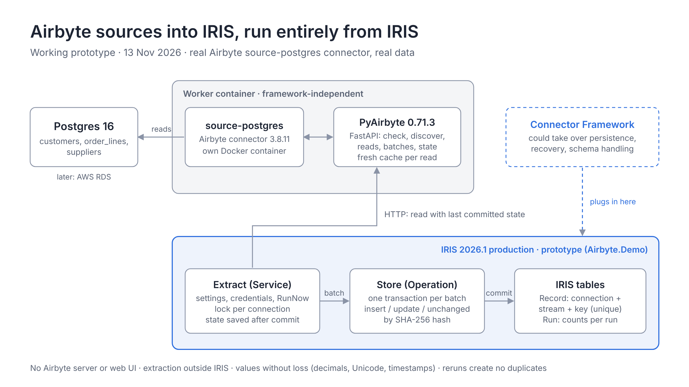

# Demo walkthrough

This walkthrough runs the prototype on your machine in about 15 minutes. It loads three Postgres tables into IRIS through the Airbyte `source-postgres` connector, then shows inserts, updates, unchanged records, reruns without duplicates, and where to look in IRIS.

Everything is started from IRIS. There is no Airbyte server or web UI.



## What you need

- Docker Desktop (Windows or macOS) or Docker Engine (Linux) with Compose v2
- About 5 GB free disk space (IRIS, Postgres, the worker and the connector image)
- Ports 52773, 1972, 8000 and 5433 free

## 1. Start it (about 3 minutes the first time)

```bash
git clone https://github.com/mwaseem75/iris-airbyte-adapter.git
cd iris-airbyte-adapter
cp .env.example .env                          # Windows PowerShell: Copy-Item .env.example .env
docker pull airbyte/source-postgres:3.8.11
docker compose up -d --build --wait
```

`--wait` returns when IRIS has loaded the classes and started the production.

Two shortcuts make the rest easier.

PowerShell:

```powershell
function iris { docker exec -i iris iris session IRIS -U USER @args }
function pg   { docker exec postgres psql -U demo -d demo @args }
[Console]::OutputEncoding = [Text.Encoding]::UTF8
```

bash / zsh:

```bash
iris() { docker exec -i iris iris session IRIS -U USER "$@"; }
pg()   { docker exec postgres psql -U demo -d demo "$@"; }
```

On Windows, use PowerShell rather than Git Bash: Git Bash rewrites the `/scenarios/...` paths below.

Check that everything is up:

```bash
iris "##class(Airbyte.Demo.Util).Status()"
```

Expected:

```
production: RUNNING (Airbyte.Demo.Production)
credentials 'Postgres': yes
stored records: 0
```

## 2. Look at the source data

```bash
pg -c "SELECT id, name, email, balance, updated_at FROM customers ORDER BY id"
pg -c "SELECT * FROM order_lines ORDER BY order_id, line_no"
pg -c "SELECT * FROM suppliers ORDER BY id"
```

Things to notice:

- Unicode names (`Zoë Müller`, Arabic), a null email, decimals such as `120.50` and `10000000.00`
- `order_lines` has a composite key (`order_id`, `line_no`)
- Customer 1 and supplier 1 both have id `1`
- `customers` and `suppliers` have an `updated_at` column; `order_lines` has none

## 3. The production

Open the Management Portal (login `_SYSTEM` / `SYS`):

http://localhost:52773/csp/user/EnsPortal.ProductionConfig.zen?$NAMESPACE=USER

`Airbyte.Demo.Production` has two items:

| Item | Class | Role |
|---|---|---|
| Extract | `Airbyte.Demo.Service.Extract` | Business Service. Holds the settings (worker URL, streams, cursor fields, mode, batch size, credentials), calls the worker, sends the batches, saves the source state |
| Store | `Airbyte.Demo.Operation.Store` | Business Operation. Writes each batch in one transaction: insert, update or skip |

Polling is switched off (`PollingEnabled = 0`), so runs start on demand with `RunNow()`. The Postgres user and password are in the credentials entry `Postgres`, created at startup from `.env`.

## 4. First run

```bash
iris "##class(Airbyte.Demo.Service.Extract).RunNow()"
```

A run takes about 30 seconds. Most of that is the Java connector starting in its own container; run `docker ps` in another terminal during a run to see it appear and go away.

Expected:

```
state BEFORE run: <none>
  customers: read=5 inserted=5 updated=0 unchanged=0 rejected=0
  order_lines: read=5 inserted=5 updated=0 unchanged=0 rejected=0
  suppliers: read=3 inserted=3 updated=0 unchanged=0 rejected=0
state AFTER run (saved after all batches were OK): [...]
run 1: Completed read=13 inserted=13 updated=0 unchanged=0 rejected=0
```

## 5. What is stored in IRIS

```bash
iris "##class(Airbyte.Demo.Util).Records()"
iris "##class(Airbyte.Demo.Util).Key()"
```

`Records()` shows 13 rows: 5 customers, 5 order lines, 3 suppliers.

`Key()` shows every row with key `["1"]`: one in `customers` and one in `suppliers`. A record's identity is connection + stream + key, enforced by a unique index, so the two never overwrite each other.

Or in SQL (Portal → System Explorer → SQL, namespace USER):

```sql
SELECT Stream, RecordKey, Hash, Data FROM Airbyte_Demo_Data.Record ORDER BY Stream, RecordKey
```

`Data` holds the record as JSON, with decimals as strings (`"120.50"`), timestamps in ISO 8601 with offset, and nulls kept.

## 6. Rerun with no changes

```bash
iris "##class(Airbyte.Demo.Service.Extract).RunNow()"
iris "##class(Airbyte.Demo.Util).Records()"
```

Expected: `run 2: Completed read=7 inserted=0 updated=0 unchanged=7`, and still 13 rows.

Why 7 and not 0:

- `customers` and `suppliers` are read incrementally on `updated_at`. Airbyte compares the cursor with "greater than or equal", so each run returns the last row again (1 + 1).
- `order_lines` has no cursor column, so it is read in full (5).

All 7 have the same content hash as what is stored, so they are counted as unchanged. Nothing is written twice.

## 7. Change the source

```bash
pg -f /scenarios/01_update_customer.sql      # customer 1: balance + 10, updated_at = now()
pg -f /scenarios/02_insert_customer.sql      # new customer 6
iris "##class(Airbyte.Demo.Service.Extract).RunNow()"
```

Expected:

```
  customers: read=3 inserted=1 updated=1 unchanged=1
  order_lines: read=5 inserted=0 updated=0 unchanged=5
  suppliers: read=1 inserted=0 updated=0 unchanged=1
run 3: Completed read=9 inserted=1 updated=1 unchanged=7 rejected=0
```

`Records()` now shows 14 rows. The scenario files set `updated_at = now()`: an incremental read only sees rows whose cursor moved.

## 8. Change a table without a cursor

```bash
pg -f /scenarios/03_update_order_line.sql    # order 1, line 1: qty + 1
iris "##class(Airbyte.Demo.Service.Extract).RunNow()"
```

Expected: `order_lines: read=5 inserted=0 updated=1 unchanged=4`. The table is read in full and the hash finds the one changed row.

## 9. Runs, messages and state

```bash
iris "##class(Airbyte.Demo.Util).Runs()"
iris "##class(Airbyte.Demo.Util).State()"
```

- `Runs()` lists every run with read / inserted / updated / unchanged / rejected counts.
- `State()` shows the Airbyte source state IRIS stored: the `updated_at` position per incremental stream. IRIS sends it to the worker with each read, and saves the new one only after every batch has been committed. If a run fails, the state does not move and the next run reads the same records again; the unique key makes that safe.

In the portal, open the Message Viewer and pick the latest session to see the Visual Trace: Extract sends one `Batch` message per stream to Store and gets the counts back.

http://localhost:52773/csp/user/EnsPortal.MessageViewer.zen?$NAMESPACE=USER

## 10. The worker API (optional)

The worker has its own API docs at http://localhost:8000/docs.

- `GET /env` shows the versions in use.
- `POST /spec` returns the connector's settings as JSON Schema and the list of secret fields.
- `POST /discover` lists streams, keys and sync modes. Try it from the docs page with this body (use the password from your `.env`):

```json
{
  "connector": "source-postgres",
  "version": "3.8.11",
  "config": {
    "host": "host.docker.internal",
    "port": 5433,
    "database": "demo",
    "username": "demo",
    "password": "change-me",
    "schemas": ["public"],
    "ssl_mode": {"mode": "disable"},
    "replication_method": {"method": "Standard"},
    "tunnel_method": {"tunnel_method": "NO_TUNNEL"}
  }
}
```

The host is `host.docker.internal` because the connector runs in its own container, outside the compose network.

Worker tests:

```bash
docker compose exec worker pytest -q
```

## Start again

Reset both sides to the seed data:

```bash
pg -f /scenarios/00_reset_source.sql
iris "##class(Airbyte.Demo.Util).Reset()"
```

Or remove everything, including volumes: `docker compose down -v`.

## Where to look in the code

| What | File |
|---|---|
| Calls the worker, sends batches, saves state after commit | `src/cls/Airbyte/Demo/Service/Extract.cls` |
| Insert / update / unchanged by hash, one transaction per batch | `src/cls/Airbyte/Demo/Operation/Store.cls` |
| Stored records, unique index on connection + stream + key | `src/cls/Airbyte/Demo/Data/Record.cls` |
| Worker API | `worker/app/main.py` |
| Running the connector, reading its output, state in and out | `worker/app/runner.py` |
| Value conversion and record keys | `worker/app/canonical.py` |
| Timeout handling | `worker/app/isolation.py` |
| Design notes | `docs/design.md` |

## If something goes wrong

| Symptom | What to do |
|---|---|
| `Status()` shows `STOPPED` | `iris "##class(Airbyte.Demo.Production).Setup()"`, or press Start on the Production page |
| A run says `timeout` | The run took longer than the `ReadTimeout` setting (600 s) and was stopped; the state was not saved. Run it again. If it repeats: `docker compose restart worker` |
| A run says `ConfigError` | The message says what to fix, for example `authentication failed: check the credentials entry 'Postgres'`. Nothing is retried. Fix it and run again (`Production.Setup()` recreates the demo credentials) |
| The run output says `temporary error ... retry 1 of 3` | The worker or the source was not reachable. The run repeats from the saved state after 5, 10 and 20 s; the Run row shows `Retries` |
| `Skipped ... worker is busy (409)` or `another run is active` | A previous run is still going. Wait 30 seconds and try again |
| The connector cannot reach Postgres | Check `docker compose ps`. The connector uses `host.docker.internal:5433`; change `POSTGRES_HOST_PORT` in `.env` if 5433 is taken (and the `port` in the `ConnectorConfig` setting of Extract) |
| Counts differ from this page | A step was already run. Use "Start again" and continue from step 4 |
| The first run is slow | The first run after a start takes longer (about 45 s) |
