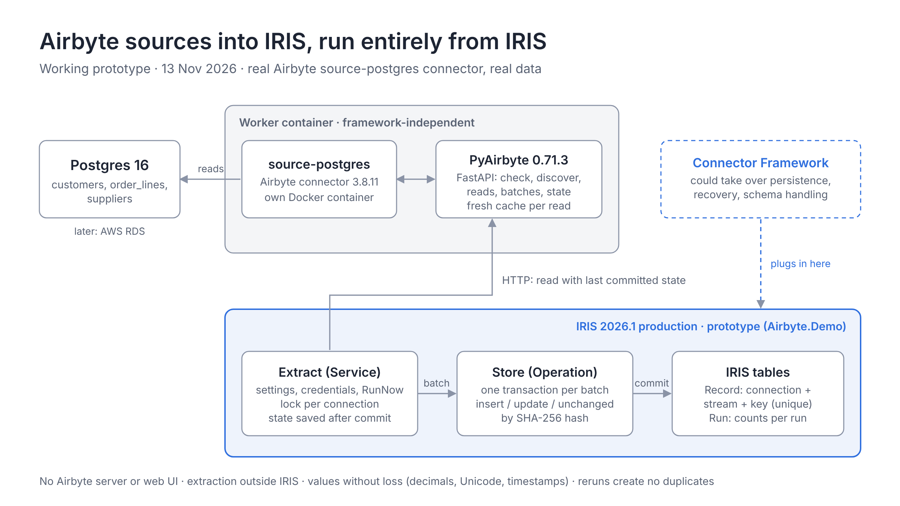

# iris-airbyte-adapter (prototype)

Load data from Airbyte sources into InterSystems IRIS, set up and run entirely from an IRIS production. No Airbyte server or web UI.

> **Status: working prototype.** The IRIS storage part (package `Airbyte.Demo`) is prototype code. The extraction worker is designed to be framework-independent.

**To try it, follow [DEMO.md](DEMO.md).**



## How it works

1. An IRIS Business Service (`Airbyte.Demo.Service.Extract`) asks the worker to read, passing the last committed source state.
2. The worker (Python, FastAPI + [PyAirbyte](https://github.com/airbytehq/PyAirbyte)) runs the real Airbyte `source-postgres` connector in its own Docker container and returns the records in batches, plus the new state.
3. A Business Operation (`Airbyte.Demo.Operation.Store`) writes each batch in one transaction: insert new keys, update changed records, skip unchanged ones (SHA-256 hash).
4. The service saves the new state only after every batch is committed.

Identity of a record is connection + stream + key, so the same key in two tables never collides. Reruns create no duplicates.

## What is in the repo

| Path | What |
|---|---|
| `worker/` | Extraction worker: `/health`, `/env`, `/check`, `/discover`, `/reads`, `/reads/{id}`, `/reads/{id}/batches/{n}`, `/reads/{id}/state`, `DELETE /reads/{id}`; pytest tests |
| `src/cls/Airbyte/Demo/` | IRIS production: service, operation, message, tables, helpers |
| `iris/` | IRIS image setup |
| `demo/` | Seed data and live-change scenarios |
| `docs/` | Design notes |
| `docker-compose.yml` | IRIS, Postgres (demo source), worker |

## Run it

Requirements: Docker Desktop (or Docker Engine) with Compose v2.

```bash
cp .env.example .env          # set POSTGRES_PASSWORD
docker pull airbyte/source-postgres:3.8.11   # first run otherwise downloads the connector image
docker compose up -d --build --wait
```

Then, in the IRIS container (`docker exec -it iris iris session IRIS -U USER`):

```objectscript
do ##class(Airbyte.Demo.Util).Status()              // production running, credentials present
do ##class(Airbyte.Demo.Util).Spec()                // the connector's settings, required and secret fields
do ##class(Airbyte.Demo.Util).Check()               // validate the connection
do ##class(Airbyte.Demo.Util).Discover()            // streams, keys, cursors, sync modes
do ##class(Airbyte.Demo.Service.Extract).RunNow()   // first run: 13 read, 13 inserted
do ##class(Airbyte.Demo.Util).Records()             // rows per stream
do ##class(Airbyte.Demo.Service.Extract).RunNow()   // rerun: 7 read, 7 unchanged, no duplicates
do ##class(Airbyte.Demo.Util).Key()                 // key ["1"] stored once per stream
```

Change the source and run again:

```bash
docker exec postgres psql -U demo -d demo -f /scenarios/01_update_customer.sql
docker exec postgres psql -U demo -d demo -f /scenarios/02_insert_customer.sql
# RunNow again: 1 inserted, 1 updated
docker exec postgres psql -U demo -d demo -f /scenarios/03_update_order_line.sql
# RunNow again: order_lines 1 updated, 4 unchanged
```

Other helpers: `Airbyte.Demo.Util` `Runs()`, `State()`, `Reset()`. To reset the source: `/scenarios/00_reset_source.sql`.

Management Portal: http://localhost:52773/csp/sys/UtilHome.csp (local demo login `_SYSTEM` / `SYS`). The Message Viewer shows each run as Extract → Store messages.

Step-by-step walkthrough with expected results: [`DEMO.md`](DEMO.md). Design notes: [`docs/design.md`](docs/design.md).

## Tested versions

| Component | Version |
|---|---|
| InterSystems IRIS Community | 2026.1 (`latest-em`) |
| Worker | Python 3.11, PyAirbyte 0.71.3 |
| Airbyte connector | `airbyte/source-postgres:3.8.11` |
| Demo source | Postgres 16 |

## Known limits (prototype)

- One tested source: Postgres via `source-postgres`. The IRIS side is connector-neutral (settings `ConnectorName`, `ConnectorVersion`, `ConnectorConfig` as JSON, `CredentialFields`), but the worker only runs connectors listed in `ALLOWED_CONNECTORS` (default `source-postgres`).
- The IRIS demo waits for each read to finish (about 25 s, because the Java connector starts). The worker can also run reads in the background (`wait=false`) with progress, batches available while reading, and cancel; the IRIS side does not use this yet.
- Incremental reads need a cursor column (e.g. `updated_at`); Airbyte returns the boundary row again on each run, counted as unchanged.
- Recovery beyond "state is saved only after commit" is not implemented yet.
- Demo credentials only; not for production use.

## License

MIT (this repository's code). Third-party: PyAirbyte and Airbyte connectors are licensed under the Elastic License 2.0 (ELv2) by Airbyte, Inc.
